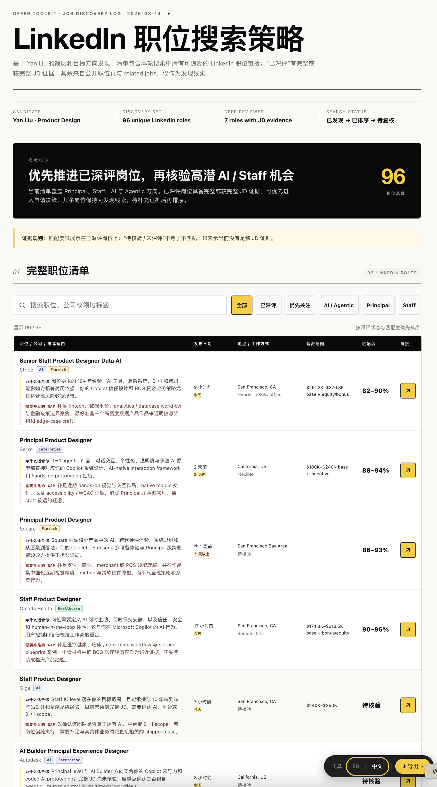
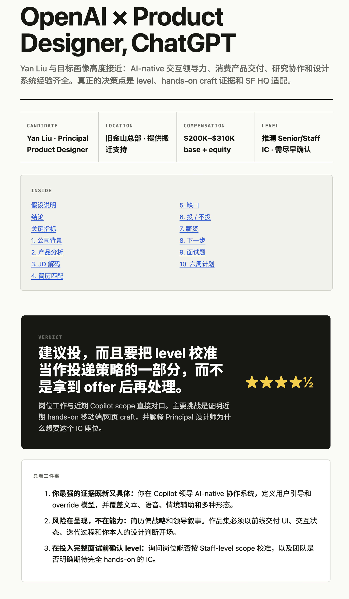
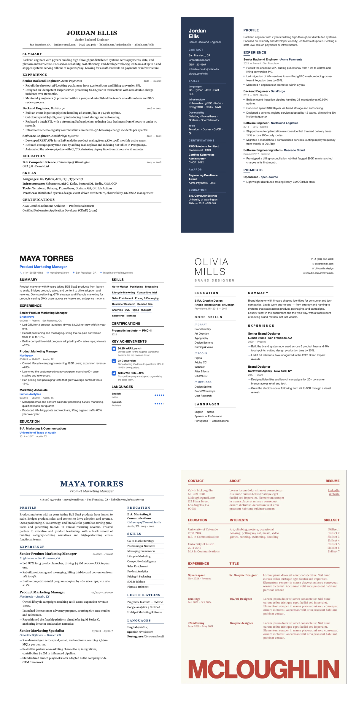
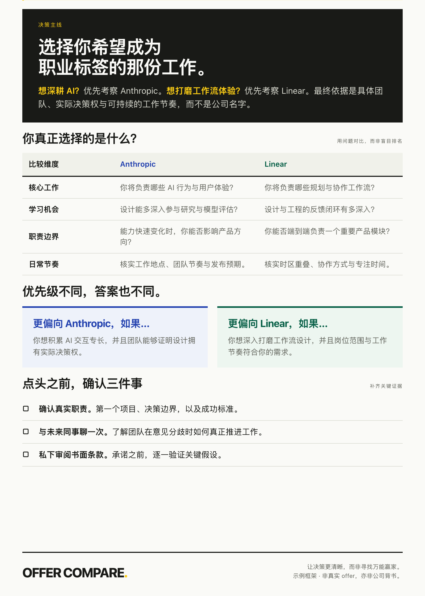

<div align="center">

**中文** · [English](./README.md)

# 🧰 Offer Toolkit

---

**六个求职工具打包成一个 agent skill 包 — Search · JD · Resume · BQ · Compare · Negotiate。**

[](./LICENSE)


[](https://github.com/yanliudesign/offer-toolkit-skill/stargazers)


[](https://claude.ai/code)


</div>

六个求职工具打包成一个 agent skill 包。可以整包用，也可以只挑其中一个——每个子目录都能独立跑。

**快速导航：** [技能介绍](#里面有什么) · [查看示例](#示例) · [安装](#安装) · [立即上手](#30-秒上手) · [常见问题](#常见问题)

| 阶段 | Skill | 做什么 |
|---|---|---|
| 0 · 还在找机会 | [job-hunt-skill](./job-hunt-skill/) | 批量发现、去重并生成可搜索清单。 |
| 1 · 看到心动岗位 | [job-description-skill](./job-description-skill/) | 解码 JD，生成 Offer Strategy 报告。 |
| 2 · 决定投 | [resume-skill](./resume-skill/) | 修改简历，提供 12 套打印级模板。 |
| 3 · 拿到面试 | [bq-skill](./bq-skill/) | 挖故事、建故事库并准备 BQ。 |
| 4 · 拿到多个 offer | [offer-compare-skill](./offer-compare-skill/) | 对比 TC、成长与风险，给出明确推荐。 |
| 5 · 准备签 offer | [salary-negotiation-skill](./salary-negotiation-skill/) | 诊断杠杆、生成话术并明确停止线。 |

## 里面有什么

<table>
<thead><tr><th width="30%">子 skill</th><th>做什么</th></tr></thead>
<tbody>
<tr><td><strong><a href="job-hunt-skill/">job&#8209;hunt&#8209;skill</a></strong></td><td>给一份简历、目标方向、种子 JD 或已有职位链接，自动搜索公开来源、去重并区分事实与推断，生成可搜索筛选的 HTML 职位清单。只发现和分析，不自动投递。</td></tr>
<tr><td><strong><a href="job-description-skill/">job&#8209;description&#8209;skill</a></strong></td><td>贴一份 JD 和你的简历，给你一份 HTML 报告，告诉你：这岗位到底该不该投、你和它多匹配、差在哪里、面试大概会问什么、薪资合不合理、接下来 6 周该做什么。</td></tr>
<tr><td><strong><a href="resume-skill/">resume&#8209;skill</a></strong></td><td>帮你把现有简历改好看，或者从 LinkedIn 导入，再或者聊着聊着帮你从零写一份。给你 <strong>12 套打印级模板</strong>（Classic-ATS、Ledger、Modern Sidebar、Pillar、Elegant Serif、Atelier、Timeline、Swiss、Executive、Editorial Banner、Photo Corporate、Photo Minimal）。每次同时给你两份文件：一份直接可以打印成 PDF，一份在浏览器里点字就能改。</td></tr>
<tr><td><strong><a href="bq-skill/">bq&#8209;skill</a></strong></td><td>不是给你现成答案，而是帮你把过去真实做过的事情挖出来、整理成一个可以反复用的故事库。它会一步步追问你的经历，帮你用 STAR/CAR 理清思路，打上“主动担当”“应对模糊情境”这类标签，中英文各存一份，下次碰上不同行为面试题也能用同一个故事。还能对着一份 JD，预测这家公司会问的 20 道题，帮你逐题准备。</td></tr>
<tr><td><strong><a href="offer-compare-skill/">offer&#8209;compare&#8209;skill</a></strong></td><td>对比两份或多份 offer 的 4 年 TC、成长、AI 敞口、公司与团队风险、晋升、生活方式、简历价值和未来跳槽便利，生成 HTML Offer Decision Report，并给出明确推荐。</td></tr>
<tr><td><strong><a href="salary-negotiation-skill/">salary&#8209;negotiation&#8209;skill</a></strong></td><td>诊断 Base、RSU、Sign-on、Bonus 的谈判空间，制定策略，生成可直接使用的中英文电话/邮件话术，模拟招聘官 pushback，并在 HTML Negotiation Playbook 中写清签、走和停止线。</td></tr>
</tbody>
</table>

## 示例

<table>
<tr>
<td width="33%" align="center"><h2>01 · 岗位发现</h2></td>
<td width="34%" align="center"><h2>02 · JD 解码</h2></td>
<td width="33%" align="center"><h2>03 · 简历</h2></td>
</tr>
<tr>
<td valign="top"></td>
<td valign="top"></td>
<td valign="top"></td>
</tr>
<tr>
<td valign="top"><sub>岗位排序、证据标签和快速筛选。</sub></td>
<td valign="top"><sub>岗位匹配度、能力差距、面试预测、薪资分析和行动计划。</sub></td>
<td valign="top"><sub>12 套打印级版式，支持浏览器编辑和 PDF 导出。</sub></td>
</tr>
<tr>
<td align="center"><h2>04 · 行为面试</h2></td>
<td align="center"><h2>05 · OFFER 对比</h2></td>
<td align="center"><h2>06 · 薪资谈判</h2></td>
</tr>
<tr>
<td valign="top"></td>
<td valign="top"></td>
<td valign="top"></td>
</tr>
<tr>
<td valign="top"><sub>Top 20 面试题、STAR 模板和可编辑的示例答案。</sub></td>
<td valign="top"><sub>对比 4 年总包、成长空间和隐藏风险，并给出明确推荐。</sub></td>
<td valign="top"><sub>诊断谈判杠杆，生成反提策略、沟通话术和决策边界。</sub></td>
</tr>
</table>

## 四条共用规则

1. **不杜撰。** 所有经历、职责、数字都来自用户真实说过的内容。可以帮改弱表达，但绝不编公司、职位、成果、量化数字。数字都要向用户求证。
2. **只问会改变结论的信息。** 遵循各子 skill 规定的逐题或批量提问节奏，不把对话变成长问卷。
3. **先结构化再产出。** 先落到标准数据模型，确认无误再渲染 HTML 或生成答案。
4. **不替用户投递。** 岗位搜索可以自动化，Apply、填写表单和发送消息必须由用户本人完成。

## 安装

把整个 `offer-toolkit-skill/` 目录放进客户端支持的 skills 目录，保留顶层 `SKILL.md` 和六个子 skill 目录。顶层 skill 会根据请求路由到对应流程。

以 Claude Code 的用户级安装为例：

```text
~/.claude/skills/offer-toolkit-skill/
├── SKILL.md
├── job-hunt-skill/
├── job-description-skill/
├── resume-skill/
├── bq-skill/
├── offer-compare-skill/
└── salary-negotiation-skill/
```

只想装一个？把对应子目录单独复制到 skills 目录即可，每个都自包含。例如，将 Resume Skill 安装到 `~/.claude/skills/resume-skill/`，保留其中的 `SKILL.md` 和配套文件。

**其他客户端：** 请使用对应客户端文档指定的 skills 路径。嵌套 skill 的发现机制不同，整包安装不代表六个子 skill 都会被单独注册；如果需要直接发现某个子 skill，可将其目录独立安装。安装后新开对话或重新加载 agent，再明确调用，例如：“使用 offer-toolkit-skill 帮我准备面试。”

> 🔒 **生成文件保存在本机。** 报告、简历和故事库会写入你的本地磁盘；你提交的提示词和附件如何被处理，取决于所使用的 agent 与模型服务商的数据政策。

### 30 秒上手

装完以后，复制任意一条到 Claude Code / VS Code 对话框：

```text
这个岗位我该不该投？我接下来会贴 JD 链接或全文。
```

```text
根据这份 JD 和我的简历，在 LinkedIn 找适合我的岗位。
```

```text
帮我美化一下简历，我接下来会上传 PDF。
```

```text
帮我准备 behavioral interview。
```

```text
帮我比较这两份 offer，明确告诉我选哪份。
```

```text
帮我谈一下这份 offer。
```

顶层 router 会路由到对应子 skill，在本地生成报告、简历或故事库，并告知实际保存路径。

## 常见问题

<details>
<summary><strong>需要安装全部六个 skill 吗？</strong></summary>

不需要。安装整个工具包可以自动覆盖完整求职流程；如果只需要其中一项，单独复制对应子目录即可。每个子 skill 都是自包含的。
</details>

<details>
<summary><strong>六个 skill 必须按顺序使用吗？</strong></summary>

不需要。刚开始求职时可以走完整流程，但也可以从当前阶段直接开始。已经拿到面试，就从 BQ Skill 开始；已经拿到 offer，就直接使用 Offer Compare 或 Salary Negotiation。
</details>

<details>
<summary><strong>为什么安装后没有触发？</strong></summary>

先确认目录中仍保留 `SKILL.md`，安装后再新开一个对话或重新加载 agent。也可以直接点名调用，例如：“使用 resume-skill 帮我改这份简历。”
</details>

<details>
<summary><strong>可以在 Claude Code、Codex 或 VS Code 中使用吗？</strong></summary>

可以，前提是客户端支持 `SKILL.md` 格式的 agent skill 或 workspace instructions。不同客户端的安装目录和发现机制可能不同，请以对应客户端的最新文档为准。
</details>

<details>
<summary><strong>它免费吗？需要 API Key 吗？</strong></summary>

工具包本身开源，不需要单独的 API Key。你仍需使用兼容的 AI 客户端；是否需要订阅、按量付费或配置身份验证，取决于你选择的服务商。
</details>

<details>
<summary><strong>生成的文件保存在哪里？</strong></summary>

大多数 HTML 报告默认保存到 `~/Desktop/Claude skills/`。故事库、已分析 JD 等长期记录可能保存在对应子 skill 目录中。任务完成后，agent 应明确告诉你实际输出路径。
</details>

<details>
<summary><strong>它会自动投递职位或替我发消息吗？</strong></summary>

不会。它可以发现并分析公开职位，但申请、填写表单、联系招聘方和操作账号都必须由你本人完成。
</details>

## 触发词

| 用户说 | 走哪个 |
|---|---|
| "帮我找工作" / "在 LinkedIn 搜适合我的岗位" / "根据简历做职位清单" | job-hunt-skill |
| 贴 JD / "这个岗位该不该投" / "帮我看看这份工作" | job-description-skill |
| "帮我美化简历" / "帮我从零做一份" / 上传 PDF / 贴 LinkedIn | resume-skill |
| "帮我准备 behavioral 面试" / "Tell me about a time…" / "帮我挖一个故事" | bq-skill |
| "帮我比较两份 offer" / "A 还是 B" / "算一下 4 年 TC" | offer-compare-skill |
| "帮我谈薪" / "怎么 counter" / "能不能多要 RSU" | salary-negotiation-skill |
| 只说“求职”但意图不明确 | 顶层 [SKILL.md](SKILL.md) 追问当前所处阶段 |

## 目录结构

```
offer-toolkit-skill/
├── SKILL.md                        # 路由：意图 → 子 skill
├── README.md / README.zh.md
├── LICENSE                         # MIT
├── job-hunt-skill/                 # ⓪ 完整可搜索职位清单
├── job-description-skill/          # ① JD 解码 + Offer Strategy 报告
├── resume-skill/                   # ② 简历生成 + 12 套模板
├── bq-skill/                       # ③ 行为面试 / 故事库
├── offer-compare-skill/            # ④ 多 Offer 对比 + 决策报告
└── salary-negotiation-skill/       # ⑤ 薪资谈判 + 可执行话术
```

六个子 skill 都有各自的 `SKILL.md`、中英文 README，以及对应流程所需的配套资源。

## 独立仓库

这六个 skill 也各自有独立仓库，独立维护：

- [job-hunt-skill](https://github.com/yanliudesign/job-hunt-skill)
- [job-description-skill](https://github.com/yanliudesign/job-description-skill)
- [resume-builder-skill](https://github.com/yanliudesign/resume-builder-skill)
- [Behavior-question-skill](https://github.com/yanliudesign/Behavior-question-skill)
- [offer-compare-skill](https://github.com/yanliudesign/offer-compare-skill)
- [salary-negotiation](https://github.com/yanliudesign/salary-negotiation)

这个 bundle 只是把它们放到一起，多加一层顶层路由。

## License

MIT 协议 — 随便 fork、改造、发一个你自己的版本。

Created by [Dreameryanyan](https://www.linkedin.com/in/yanliudesign/) ·
[LinkedIn](https://www.linkedin.com/in/yanliudesign/) ·
[X](https://x.com/yanliudreamer) ·
[小红书](https://www.xiaohongshu.com/notification)
